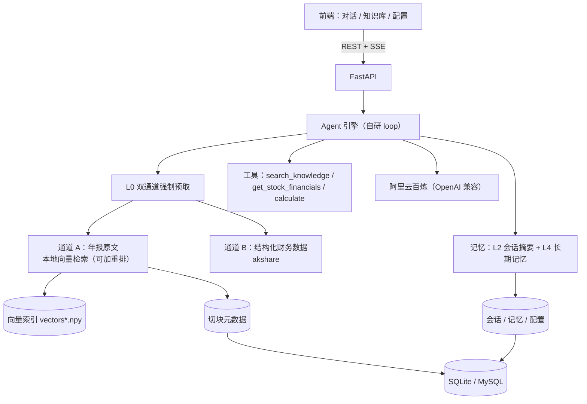

# FinAgent · 上市公司财报分析 Agent

> 用自然语言问一家 A 股上市公司的财报，Agent 自动取来**年报原文**和**结构化财务数据**，
> 给出**带来源标注**的回答 —— 不用在年报 PDF、行情软件、计算器之间来回切。


单机运行 · 只读公开数据 · 不构成投资建议

📄 深入阅读：[架构说明](docs/architecture.md) · [Prompt 策略](docs/prompt-strategy.md) · [踩坑记录](docs/pitfalls.md) · [评测结果](eval/results.md) · [检索实验](eval/retrieval_report.md)

**当前状态一句话**：三页前端 + SQLite/MySQL 双库跑通；20 题端到端评测**自动初判 20/20**；
检索经 **8 档对比实验**优化（MRR +16%）；评测证据链经过**人工校验**。
**未部署上线（没有公网 demo 链接）**：本机可一键起（含 Docker Compose），但没放到服务器上，
所以没有可以点开的在线地址（已知边界见第 11 节）。

---

## 1. 它解决什么问题

想搞清"某公司 2025 年营收多少、同比怎么变、管理层怎么解释"，得翻 100–300 页年报、
另开数据网站、自己算 —— 成本高，还容易抄错数。

**一句话问出结论，且每个结论都能追到出处。**

## 2. 效果（20 题实测）

| 指标 | 结果 | 对照标准 |
|---|---|---|
| 完成题数 | 20 / 20（每题开新会话） | — |
| **自动初判通过** | **20 / 20** | — |
| 首字延迟 中位 / P95 | 2.04s / **2.44s** | P95 < 3s ✅ |
| 完成延迟 中位 / P95 | **7.64s / 9.97s** | P95 < 20s ✅ |
| 答案字数 中位 / P95 | **354 / 484** | — |
| token 中位 / 合计 | 3175 / 74613 | — |
| 可疑引用 / 未接地 / 报错 | 0 / 0 / 0 | 趋零 ✅ |

评测前先**冻结配置快照**（模型、工具开关、记忆参数），逐题明细见 [`eval/results.md`](eval/results.md)。

**两轮优化的对照**（同一套 20 题，其余配置不动）：

| 指标 | ① 优化前 | ② 检索优化后 | ③ +输出精简后 |
|---|---|---|---|
| 自动初判通过 | 19 / 20 | 20 / 20 | **20 / 20** |
| 首字 中位 / P95 | 1.82 / 2.34 | 2.04 / 3.29 ⚠️ | 2.04 / **2.44** ✅ |
| 完成 中位 / P95 | 10.44 / 17.06 | 10.02 / **22.6** ⚠️ | **7.64 / 9.97** ✅ |
| token 合计 | 93211 | 95085 | **74613** |

两轮各解决了不同的问题，也都各自引入了新问题、再被下一轮修掉：

1. **检索优化（索引变体）**：修好了"答不出"（两道原答不出的题现在能答），
   但**答案变长**（拿到更多材料就写更多）→ 完成延迟 P95 从 17s 涨到 **22.6s**；
2. **输出精简（提示词）**：把"字数"要求从**抽象**（"简洁直接，不要长篇铺陈"）改成**具体**
   （分点 / 每点一句 / 定性 ≤300 字 · 对比 ≤500 字 / 禁止结尾主动追问 / 不复述问题与资料）
   → 答案 1722 字压到 412 字，**完成延迟 P95 降到 9.97s，且 20 题通过率不变、要点覆盖经人工抽查无缺失**。

> **注意**：`MAX_OUTPUT_TOKENS` **没有动**（仍是 1500）—— 它的作用是**防跑飞**，不是压缩工具。
> 靠"一开始就写短"解决，而不是"写长了再砍"。

一次典型问答：

```text
问：贵州茅台 2025 年的营业总收入是多少？用亿元表示

答：1,720.54 亿元（B）
     ↑ 来源标注：A = 年报原文片段（带文件名与页码），B = 结构化财务数据（akshare）
```

> 这一条也顺带验证了早期那个缺陷的修复：模型心算单位换算会错 10 倍
> （`172,054,171,890.91 元` 写成「172.05 亿元」）。
> 修法不是加提示词，而是**让数据自带换算结果** + 要求换算走 `calculate`。
> **重测 20 题已无此类错误。**

## 3. 快速开始

需要 Python 3.10+ 和一个阿里云百炼（DashScope）API Key —— 用于**向量化**与**生成回答**。

Windows（PowerShell）：

```powershell
python -m venv .venv
.venv\Scripts\Activate.ps1
pip install -r requirements.txt

Copy-Item .env.example .env     # 打开 .env，填入 DASHSCOPE_API_KEY

python scripts\ingest.py --dir data\raw --limit 1   # 先入 1 份验证链路
python scripts\ingest.py --dir data\raw             # 再入全部 4 份年报
python scripts\ingest.py --stats                    # 看索引状态

python -m uvicorn backend.main:app --reload
# 打开 http://127.0.0.1:8000
```

macOS / Linux：

```bash
python3 -m venv .venv && source .venv/bin/activate
pip install -r requirements.txt

cp .env.example .env            # 填入 DASHSCOPE_API_KEY

python scripts/ingest.py --dir data/raw
python -m uvicorn backend.main:app --reload
```

几点说明：

- 仓库里已附 4 份年报 PDF（茅台、美的 2024 + 2025，共约 17MB），也可以换成你自己的年报；
- 入库要调用云端 embedding，约 2100 个切块，**首次入库会产生少量 API 费用**，耗时看网络；
- 不填 Key 也能把服务起起来（`/health` 显示 `llm_ready: false`），只是问答与入库不可用；
- 其余可选项（模型调用轮次、输出上限、工具结果上限）都在 `.env.example` 里注释好了。

### 数据库：SQLite 给验证用，MySQL 给自己用

**这两条路的分工是刻意的：**

| 后端 | 定位 | 谁在用 |
|---|---|---|
| **SQLite**（默认） | **零部署** —— 让人 clone 下来不配任何东西就能跑通、能验证 | 任何人拿到仓库 |
| **MySQL** | 独立服务、可远程连接（**每次操作短连接，未做连接池**，属已知取舍） | **作者本人日常使用** |

`.env` 不进 git，所以别人 clone 下来拿到的就是默认的 SQLite；作者本机那份 `.env` 里写着 MySQL。

要用 MySQL：先建库（`CREATE DATABASE finagent DEFAULT CHARACTER SET utf8mb4`），
再把 `.env` 改成 `DB_BACKEND=mysql` 并填连接参数 —— **不用改代码**。

> 已在 **MySQL 8.4 实测跑通**：6 张表由同一套建表逻辑生成、2104 个切块写入，
> 问答 / 记忆 / 配置 / 检索全流程正常，**检索结果与 SQLite 完全一致**（同题同页码同分数）。

**三条约定（防止"双后端"变乱）**：

1. 业务 SQL 只用两库都认的**公共子集** —— 不写 `ON CONFLICT` / `INSERT OR REPLACE`，需要 upsert 就写成"先判断再写"；
2. 建表语句用 `dbconn.py` 里的**类型别名**拼（`PK` / `KEY_STR` / `INT` / `REAL`），方言只出现在那一个文件；
3. **向量文件按后端分目录**（`data/index/{sqlite,mysql}/vectors.npy`）—— 向量在文件里、元数据在库里**必须成对**，所以**换后端要重新入库**。

### Docker 一键起（应用 + MySQL）

```bash
docker compose up -d          # 起 MySQL + 应用
docker compose logs -f app    # 看日志（等它连上 MySQL）
# 打开 http://127.0.0.1:8000
```

四点说明：

- **容器里的 MySQL 映射到宿主 `3307`**（不是 3306）—— 避免与本机已装的 MySQL 撞端口；
- **`DASHSCOPE_API_KEY` 从宿主 `.env` 插值进来** —— 没设会**直接报错**，不静默失败；
- **MySQL 口令同样从宿主 `.env` 插值**（`MYSQL_PASSWORD` / `MYSQL_ROOT_PASSWORD`）——
  compose 里**不内置任何默认口令**，没设会直接报错；这样仓库里不会出现真实密码；
- **`./data` 是挂载卷** —— 语料、向量索引、SQLite 都在里面，容器重建不丢；
  但**首次仍需入库一次**（和本地一样）：
  ```bash
  docker compose exec app python scripts/ingest.py --dir data/raw
  ```
- 只想快速看一眼、不想起 MySQL：直接用挂载的 SQLite 跑
  ```bash
  docker build -t finagent .
  docker run --rm -p 8000:8000 -v ./data:/app/data \
    -e DASHSCOPE_API_KEY=sk-xxx finagent
  ```

**镜像约 743MB**（实测）。

> **已实测跑通**（Windows + Docker Desktop 29.1.3）：
> - `docker compose up -d --build` 后 **app / mysql 双双 `healthy`**（`depends_on: service_healthy` 生效：等 MySQL 真能连才起 app）；
> - 容器内入库 **2104 块 / 4 份年报**，检索命中正常；
> - 容器内端到端问答正常（引用 5 条、可疑引用 0、10.2s）；
> - **镜像内只有 `.env.example`，没有 `.env`**（密钥不进镜像）。

## 4. 功能

| 页面 | 能力 |
|---|---|
| **对话** | 多轮、流式输出、Markdown、工具调用可见、引用出处（文件/页码/相似度）、会话侧栏 |
| **知识库** | 上传 PDF → 自动解析/切分/向量化/建索引；文档管理与**检索测试**（不经模型，用来调 chunk 与召回） |
| **配置** | 系统提示词、模型、工具开关、记忆策略（保留条数/压缩阈值/提炼间隔）、长期记忆管理与工作台统计 |

## 5. 架构



**云端只在两处参与**：文本向量化、生成回答。召回与比对全在本地完成。

**索引变体**（`RETRIEVAL_INDEX` 切换，缺文件自动退回 base）：
`base` 正文向量 / `ctx` 正文+章节路径 / **`llmctx` 正文+LLM 专属上下文（当前生效，实测 MRR +16%）**。

## 6. 关键实现

### 6.1 双通道强制预取（本项目的核心）

**问题**：把 RAG 做成"让模型自己调的工具"，实测**不可靠** —— 问"美的 2025 营收"，
模型会跳过工具直接凭记忆答，甚至断言"尚未发布 2025 年报"（语料里明明有）。

**做法**：涉及公司事实/数字的问题，**由代码保底取资料**，不问模型要不要查：

| 通道 | 内容 | 什么时候取 |
|---|---|---|
| **A** | 年报原文片段（本地检索，带文件名 + 页码） | 命中定性信号 |
| **B** | 结构化财务数据（akshare，**自带亿元换算**） | 命中数值信号 |

资料取好后按通道标注注入本轮消息，并要求模型**在结论后标明用的是哪条通道**。

**兜底**（硬校验，不靠模型自觉）：

- **引用校验** —— 回答里的「片段 N」不在本轮 citations 里 → 报警；
- **接地校验** —— 该取资料却什么都没取到 → **直接拒答**，不让它凭记忆作答。

### 6.2 自研 Agent 循环

`决策 → 工具执行 → 回填 → 再决策`，最多 5 次模型调用。不用框架是为了**能讲清整条链路**。

### 6.3 入库管线：难点在版面，不在扩展名

`pypdf` 抽正文 → 去页眉页脚 → 自动抽页码进 metadata → 按页切 400–600 字（重叠 90）→
云端向量化 → 本地索引（numpy + SQLite）。

**按页切、不跨页**：页码是引用锚点，跨页合并会让"这块属于哪页"说不清。

### 6.4 四层记忆

| 层 | 内容 | 实现 |
|---|---|---|
| L1 | 单次请求内的工作记忆 | 进程内 |
| L2 | 多轮原文 + **滚动摘要** | 超阈值把最老一半压成摘要，保留最近 N 条原文 |
| L3 | 年报切块与向量 | 本地持久化 |
| L4 | **关于用户**的偏好/常用公司/口径 | 自动提炼，**可见可删**，注入 system prompt |

### 6.5 检索优化：**先定尺子，再谈优化**

一开始检索很差 —— 问「贵州茅台的分红政策是怎样的？」，召回的 5 块全是基酒工艺、品牌宣传。
于是做了 **8 档配置对比实验**（20 题检索集 + 两级标注），结论有几条是反直觉的：

| 结论 | 证据（MRR） |
|---|---|
| **"关键词化"本身有害** | 0.7679 → 0.6263 |
| **去掉公司名有益**（高频词稀释语义） | 0.6263 → 0.8604 |
| **规则式章节上下文有害**（覆盖率 99.5% 却更差） | 0.7679 → 0.7216 |
| **LLM 专属上下文有效** | 0.7679 → **0.8925**，precision +27% |
| **两个有效优化会互相抵消** | ⑦+重排 → 0.7433 ↓ |

**两条方法论**，比上面的配置本身更重要：

1. **指标要先选对** —— 旧口径（"沾边也算相关"）下最优的配置，在金标口径下是最差的（0.86 vs 0.50）。
   改用**金标块命中（Pass@k）**才量出真实水平，也才看出"重排有效"。
2. **标注要两级** —— LLM 初标 → 独立盲审 → **人工裁定**。盲审一致率仅 80% 且两方都错；
   只改 5 条标注配置排名就翻转（详见 [`docs/pitfalls.md`](docs/pitfalls.md) 第 13–15 条）。
   金标块也已**人工抽查 8 条，基本一致** —— 所以**上面那张表的结论是有据的**，不是 LLM 自评自夸。

**接线后要说清的一点（不夸大）**：⑦ 的收益主要体现在**排序质量**（precision +27%、MRR +16%）
与**端到端可见的效果**（两道原先答不出的题现在答得出，20 题通过率 19→20）。
在**金标命中@5** 这个更硬的口径上，⑦ 与基线**基本持平**（均为 0.70，差 1–2 题，在噪声范围内）；
该口径下最好的是"去名关键词 + 重排"（0.80）。

当前生效：`RETRIEVAL_INDEX=llmctx`。接线后实测：**之前答不出的两道题现在都能答出** ——
「茅台分红政策」从"未找到"变成完整答出预案金额；「美的资产负债率」直接引用第 124 页，7.9s。
完整实验数据见 [`eval/retrieval_report.md`](eval/retrieval_report.md)。

## 7. 技术选型

| 决策 | 选择 | 为什么 |
|---|---|---|
| 编排 | **自研 loop**（非 LangChain） | 能讲清原理；框架会把这层藏起来 |
| 向量化 | **云端** text-embedding-v4 | 本机零算力；依赖从约 600MB 降到几十 MB |
| 向量存储 | **SQLite + numpy**（非向量数据库） | 约 2000 块规模下点积 < 5ms，能省几百 MB 依赖 |
| 关系数据库 | **SQLite / MySQL 双后端** | **SQLite 负责"clone 即跑"的验证，MySQL 是作者自己的日常形态**；切换只改 `.env` |
| 格式 | **只做文字型 PDF** | 实测巨潮年报与公告均为 PDF，不为"多格式"造需求 |
| 工具 | **全部只读** | 从架构上杜绝越权，不依赖模型自觉 |

## 8. 项目结构

```
backend/
  main.py            # FastAPI 入口 + 托管前端
  config.py          # .env 读取与默认系统提示词
  dbconn.py          # 数据库抽象层：SQLite / MySQL 双后端
  db.py              # 会话 / 消息 / 记忆 / 应用配置 / 统计
  llm.py             # 云端客户端（流式 + 工具调用 + 非流式短调用）
  agent/             # loop.py · prompts.py · gate.py · grounding.py · memory.py · rewrite.py · context.py
  rag/               # loader.py · splitter.py · embedder.py · store.py · retriever.py · rerank.py · ingest.py
  tools/             # registry.py · knowledge.py · finance.py · calc.py
  api/               # chat.py · documents.py · config.py · stats.py · memories.py
frontend/            # index.html · knowledge.html · config.html · assets/
scripts/             # ingest.py（入库）· eval.py（20 题端到端评测）
                     # retrieval_eval.py（8 档检索对比）· retrieval_audit.py（盲审+人工裁定）
                     # contextual_index.py（上下文索引构建）· retrieval_review.py（抽查表）
                     # sync_prompt.py（把代码里的系统提示词同步进库）· spike_announcement.py（公告可行性验证）
eval/                # questions.yaml（端到端）· retrieval_questions.yaml（检索）
                     # results.md · retrieval_report.md · audit_report.md（盲审与裁定）
data/raw/            # 年报 PDF（随仓库分发）
data/app.db          # SQLite 数据库；data/index/ 向量索引（均为生成物，已 gitignore）
docs/                # 架构 / Prompt 策略 / 踩坑记录（15 条）/ 事实与边界清单
.env.example         # 所有可配置项（含数据库、检索、限制项）
Dockerfile           # 应用镜像（配套 docker-compose.yml：app + MySQL）
```

## 9. 评测

**端到端（20 题，测回答质量与延迟）**：

```bash
python scripts/eval.py --limit 3    # 先跑 3 题（服务需先起）
python scripts/eval.py              # 跑全部 20 题，写出 eval/results.md
```

**检索层（20 题，测召回与排序；支持 8 档配置对比）**：

```bash
python scripts/retrieval_eval.py             # 基线 + 关键词改写 + 各索引变体
python scripts/retrieval_audit.py --packet   # 生成盲审包（不含原标注）
python scripts/retrieval_audit.py --compare  # 与原标注对比，算一致率与分歧
python scripts/retrieval_audit.py --adjudicate  # 生成人工裁定表
python scripts/retrieval_audit.py --apply    # 按人工裁定修正标注
```

**建上下文索引（可选，用于 ⑦ 那一档）**：

```bash
python scripts/contextual_index.py --probe      # 先探章节识别覆盖率（不花钱）
python scripts/contextual_index.py --build-llm  # 生成 chunk 专属上下文并建索引
```

脚本会**先冻结并记录配置快照**（否则结果不可比），每题开新会话，
输出首字/完成延迟、token、引用数、可疑引用、是否未接地。
自动初判只做粗筛，**最终判定仍需人工对照 `expect` 逐题确认**。

## 10. 踩坑与优化（工程复盘）

1. **页眉页脚清理误伤正文** —— 第一版按"跨页高频行"删，把 `单位：元 币种：人民币` 也删了。
   → 改为**只在每页首尾两行**判定。
2. **页码抽不到** —— 以为在页脚，实测在**页首**（`60 / 143`、`- 59 -`、还有页首光秃数字）。
   → 首尾都扫 + 光秃数字加"接近 PDF 页序"兜底。
3. **伪引用** —— 多轮追问时模型不检索却写「片段 3」（被历史里的编号诱导）。
   → 送模型前**剥掉历史里的引用编号** + 引用合法性校验。
4. **模型跳过工具凭记忆作答** —— 提示词软化无效。
   → 先 `tool_choice="required"` 强制，最终升级为**双通道强制预取**（由代码保底）。
5. **10 倍单位换算错误** —— `172,054,171,890.91 元` 被写成「172.05 亿元」。
   → 让结构化数据**自带亿元换算**，模型不必心算；并给注入块附单位参照表。
6. **流式下 tool_calls 是增量拼接的** —— 参数分多个 chunk 到达，必须按 index 累积。
7. **`usage` 是 SDK 对象**，直接 `json.dumps` 会炸 → 转普通 dict。
8. **两个参数管同一件事** —— `keep_recent` 与 `HISTORY_MAX_MESSAGES` 互相覆盖，
   导致配置页那个旋钮形同虚设 → 合并成一个，并加**后端校验与钳制**。
9. **加信息不总是好事** —— 给切块补章节路径（覆盖率 99.5%）反而让 MRR 从 0.7679 掉到 0.7216。
   章节标题是**高频、低区分度**的文本，拼进向量等于加噪声。
   → 与"**去掉**公司名反而变好"是同一现象：**embedding 对高频词敏感，它们稀释语义**。
10. **指标选错会让你朝反方向优化** —— 旧口径下最优的配置（去公司名，MRR 0.86），
    在金标口径下是最差的（0.50）；改用**金标块命中**才看出"重排有效"。→ **先确认尺子量的是你要的东西。**
11. **单靠一种标注源不可靠** —— 两个标注者一致率只有 80%，且**两方都错、方向相反**；
    只改 5 条标注配置排名就翻转。→ 三级流水线：LLM 初标 → 独立盲审 → **人工裁定（唯一金标准）**；
    盲审包**必须给全文**（截断会制造假分歧）。

完整版（15 条，含现象 → 根因 → 修法 → 教训）见 [`docs/pitfalls.md`](docs/pitfalls.md)。

## 11. 已知问题与边界

**检索层（做了 8 档实验后仍存在的问题）**：

- **有些题的正确块压根进不了候选池** —— 如「美的资产负债率」「茅台分红政策」在基线下 recall 为 0，
  **重排后仍是 0**。**重排只能改善排序，不能创造召回**，这是它的能力边界。
- **"沾边相关"会挤掉"有答案的"** —— 一个问题的池里常有 10–24 块沾边内容。
  向量相似度衡量的是**主题相似**，不是**能否回答问题**。
- **单块信息常常不足以作答** —— 一个块 400–600 字，而一个问题可能散在多页；top-5 之间没有上下文聚合。
- **未做**：混合检索（BM25，对精确数字/代码不友好）、查询分解与多路召回、切块粒度对比实验。

**其他**：

- ~~长回答题的尾部延迟超标~~ —— **已于 2026-10-12 解决**：把提示词里的篇幅要求从**抽象**
  （"简洁直接，不要长篇铺陈"）改成**具体**（分点 / 每点一句 / 定性 ≤300 字 · 对比 ≤500 字 /
  禁止结尾追问 / 不复述问题与资料）后，完成延迟 **P95 22.6s → 9.97s**，
  答案字数中位 **→ 354 字**，且 20 题通过率不变、要点覆盖经抽查无缺失。详见第 2 节对照表。
- **多步题 token 仍偏高**：串多个工具时 token 明显更高（实测单题最高 10201 token）。
- **akshare 取数已加磁盘缓存**（`data/cache/financials/{code}.json`，TTL 默认 12 小时，`FIN_CACHE_TTL` 可调）：
  冷 2.7s → 热 **0.00s**；**失败不缓存**（避免把一次网络抖动固化一整个 TTL）。
  **如实说明**：它**对整体 P95 无明显影响** —— 取数只占 2~3 秒，而每题总耗时 7~11 秒（大头是生成），
  且 20 题里每家公司只冷一次。**真正受益的是"连续追问同一家公司"的场景**（每次都省 2~3 秒）。
  不把它算成性能优化，算**工程正确性**（数据幂等、减少第三方调用、重启不丢）。
- **评测是 20 题自评**，小样本，结论只作趋势参考；金标块由 LLM 选取后**已人工抽查 8 条（基本一致）**，
  但**不是全量人工标注** —— 所以第 6.5 节的结论可以说"方向可信"，不宜说"精确提升了 X%"。
- **单机单用户**：接口无鉴权、上传未做大小与文件名净化，请勿直接暴露到公网。
- **本版不做**：扫描件 OCR（明确报错不静默降级）、PDF 以外的格式、向量数据库、LangChain 版对比。

## 12. 想快速读懂这个项目？

| 顺序 | 文件 | 看什么 |
|---|---|---|
| 1 | `backend/agent/loop.py` | 一轮问答的完整编排：改写 → 门控 → 预取 → 循环 → 校验 |
| 2 | `backend/agent/gate.py` | "要不要取资料"如何变成确定性判断（而不是靠模型自觉） |
| 3 | `backend/agent/grounding.py` | 双通道预取与注入块组装 |
| 4 | `backend/rag/loader.py` | 版面处理：页眉页脚清理与页码抽取 |
| 5 | `backend/dbconn.py` | SQLite / MySQL 双后端抽象层 |
| 6 | `backend/rag/store.py` | 索引变体（base / ctx / llmctx）与**读写路径分离** |
| 7 | `eval/retrieval_report.md` | 8 档检索对比：哪一步值、哪一步不值，都有数据 |
| 8 | `docs/pitfalls.md` | 15 条实测踩坑：现象 → 根因 → 修法 → 教训 |

---

**数据来源**：巨潮资讯网（年报原文）、akshare（结构化财务数据），均为公开信息，仅用于学习。
**免责**：本工具不构成任何投资建议。
