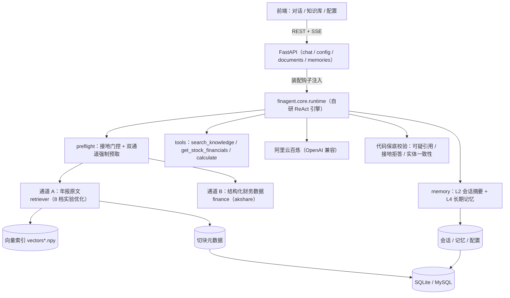

# FinAgent · 上市公司财报分析 Agent（含可复用框架 finagent-core）

> 用自然语言问一家 A 股上市公司的财报，Agent 自动取来**年报原文**和**结构化财务数据**，  
> 给出**带来源标注**的回答 —— 不用在年报 PDF、行情软件、计算器之间来回切。


单机运行 · 只读公开数据 · 不构成投资建议

📄 深入阅读：[架构说明](docs/architecture.md) · [Prompt 策略](docs/prompt-strategy.md) · [踩坑记录](docs/pitfalls.md) · [评测结果](eval/results-m4-notes.md) · [检索实验](eval/retrieval_report.md) · [阈值标定](eval/threshold-report.md) · [混合检索评估](eval/hybrid-report.md) · [改造记录](docs/refactor-log.md) · [运营记录](docs/ops-log.md) · [PRD](PRD.md)

**当前状态**：三容器部署（app / mysql / cloudflared 隧道）；**40 题端到端评测自动初判 33/40**（20 题旧集沿用历史 20/20；扩集含攻击/边界/回归类，2 个已知边界如实记录，见 [评测记录](eval/results-m4-notes.md)）；  
**100 个离线单测 + CI**（ruff + pytest，Python 3.11/3.12）；检索经 **8 档对比实验**优化（MRR +16%）+ **相关性阈值标定**；  
首轮**真实用户 30 题公网测试**的 3 项严重缺陷全部修复（见 [ops-log](docs/ops-log.md)）。

---

## 1. 它解决什么问题

想搞清"某公司 2025 年营收多少、同比怎么变、管理层怎么解释"，得翻 100–300 页年报、  
另开数据网站、自己算 —— 成本高，还容易抄错数。

**一句话问出结论，且每个结论都能追到出处。**

## 2. 效果（全部有评测记录可复跑）

### 2.1 端到端（20 题，每题新会话，配置冻结快照）

| 指标              | 结果                | 对照标准        |
| --------------- | ----------------- | ----------- |
| 自动初判通过          | **20 / 20**       | —           |
| 首字延迟 中位 / P95   | 2.04s / **2.44s** | P95 < 3s ✅  |
| 完成延迟 中位 / P95   | **7.64s / 9.97s** | P95 < 20s ✅ |
| 可疑引用 / 未接地 / 报错 | 0 / 0 / 0         | 趋零 ✅        |

### 2.2 RAG 引用命中率（13 题金标，页码经关键词页内验证 ±1 容差）

| 指标 | 迭代前 | 迭代后 |
|---|---|---|
| **引用命中率** | 70% | **100%** |
| 拒答准确率 | 100% | 100% |

> 迭代归因（如实记录）：3 个失分点**全部是度量覆盖不足而非系统缺陷**——同一内容在两版年报与
> 概述/分部信息中有多处等价出处（金标改为可接受出处列表）、数字题的出处页随查询改写动态变化
> （改为**数值一致性**判定，金标值提取自年报原文）。完整过程见 [`eval/citation-baseline.md`](eval/citation-baseline.md)。

### 2.3 攻击性用例（6 题）与真实用户测试（30 题）

- 非法地址 / 不存在字段 / 越权写入 / 规范外问题：**0 编造**；股价预测 / 套提示词：正确拒答；
- 首轮真实用户公网测试发现 3 项严重缺陷（实体错配、成本口径、伪造验算），**全部修复闭环**——
  其中"问格力电器返回美的数据"一项，根因是兜底逻辑从无关公司年报捞代码，修复为**实体一致性拦截**。  
  完整记录见 [`docs/ops-log.md`](docs/ops-log.md)。

## 3. 架构



**云端只在两处参与**：文本向量化、生成回答。召回与比对全在本地完成。

## 4. 框架 + 示范应用（本项目真正的结构）

仓库分两层：**finagent.core（框架，领域无关）** 与 **apps/finance（财报示范应用）**。

```
finagent/core/             # 框架层：零应用依赖
  runtime.py               #   AgentEngine：ReAct 循环（preflight/prompt/rewriter 钩子注入）
  tools.py                 #   工具注册表（name + JSON Schema + func）
  memory.py                #   SessionMemory：L2 摘要 + L4 长期记忆（db 适配器注入）
  retriever/               #   RAG 管线：loader（版面处理）/ splitter / embedder / store / rerank
  evaluator.py             #   三列评测框架（自动初判 / 数值一致性 / 报告渲染）
  llm.py · context.py · appconfig.py
apps/finance/  (backend/)  # 示范应用：财报领域钩子 + FastAPI + 前端
apps/announcement/         # 第二实例：公告问答（证明泛化性，见下）
```

**泛化性证明（G3）**：用同一套框架接入"公告问答"第二领域——换提示词、换工具、换语料，
框架零改动，10 题冒烟评测 10/10（见 [`eval/announcement-g3.md`](eval/announcement-g3.md)）。

多实例隔离：`DATA_DIR` / `DB_BACKEND` 环境变量驱动，每实例独立的语料、向量索引与数据库
（踩坑记录：曾因元数据共享 MySQL 而向量文件分目录，产生跨实例 split-brain——修复并有空索引护栏）。

## 5. 快速开始

需要 Python 3.10+ 和一个阿里云百炼（DashScope）API Key —— 用于**向量化**与**生成回答**。

```bash
make bootstrap      # 装锁定依赖 → 入库语料（约 2100 块，少量 embedding 费用）→ 索引体检
make serve          # 起服务 http://127.0.0.1:8000
```

（等价的手动步骤：`pip install -r requirements.lock` → 复制 `.env.example` 为 `.env` 填
`DASHSCOPE_API_KEY` → `python scripts/ingest.py --dir data/raw` → `make serve`。）

- 仓库附 4 份年报 PDF（茅台、美的 2024 + 2025）；
- 不填 Key 也能起服务（`/health` 显示 `llm_ready: false`），只是问答与入库不可用；
- **启动自检**：索引与元数据不一致会拒绝启动（fail-closed），配置问题以 JSON 告警到 stderr。

其它常用命令：

```bash
make test      # 100 个离线单测（不需要 API key，约 2s）
make lint      # ruff 检查
make eval      # 40 题端到端评测（需服务在跑）
make doctor    # 索引一致性体检（含 stale 变体与 --stamp 指纹登记）
```

### Docker 一键起（应用 + MySQL）

```bash
docker compose up -d          # 起 MySQL + 应用（app 等 MySQL healthy 才启动）
docker compose exec app python scripts/ingest.py --dir data/raw   # 首次需入库一次
# 打开 http://127.0.0.1:8000
```

### 公网演示（内网穿透）

```bash
tools-bin/cloudflared.exe tunnel --url http://127.0.0.1:8000
# 出一个 trycloudflare.com 临时 URL（无 SLA，进程停即失效；正式部署用云服务器）
```

**安全**：`.env` 配置 `ADMIN_TOKEN` 后，变更类接口（改配置/删文档/清记忆）要求
`X-Admin-Token` 头；未配置时这些接口 **fail-closed 一律 403**（实测），查询与问答保持开放。

### 数据库：SQLite 给验证用，MySQL 给自己用

| 后端 | 定位 | 谁在用 |
| --- | --- | --- |
| **SQLite**（默认） | **零部署**——clone 下来不配任何东西就能跑通 | 任何人拿到仓库 |
| **MySQL** | 真实部署形态 | 作者本人日常使用 |

切换只改 `.env`（`DB_BACKEND=mysql`），**不用改代码**。三条约定：业务 SQL 只用两库都认的公共子集、
建表类型别名只在 `dbconn.py`、**向量文件按后端分目录**（换后端要重新入库）。已在 MySQL 8.4 实测跑通，
检索结果与 SQLite 完全一致。

## 6. 功能

| 页面      | 能力                                                         |
| ------- | ---------------------------------------------------------- |
| **对话**  | 多轮、流式输出、Markdown、工具调用可见、引用出处（文件/页码/相似度）、会话侧栏               |
| **知识库** | 上传 PDF → 自动解析/切分/向量化/建索引；文档管理与**检索测试**（不经模型，用来调 chunk 与召回） |
| **配置**  | 系统提示词、模型、工具开关、记忆策略、长期记忆管理（ADMIN_TOKEN 保护变更接口）            |

## 7. 关键实现

### 7.1 双通道强制预取（本项目的核心）

**问题**：把 RAG 做成"让模型自己调的工具"，实测**不可靠**——问"美的 2025 营收"，
模型会跳过工具直接凭记忆答，甚至断言"尚未发布 2025 年报"（语料里明明有）。

**做法**：涉及公司事实/数字的问题，**由代码保底取资料**，不问模型要不要查：

| 通道    | 内容                          | 什么时候取  |
| ----- | --------------------------- | ------ |
| **A** | 年报原文片段（本地检索，带文件名 + 页码）      | 命中定性信号 |
| **B** | 结构化财务数据（akshare，**自带亿元换算**） | 命中数值信号 |

**兜底（硬校验，不靠模型自觉）**：引用校验（「片段 N」不在本轮 citations → 报警）、
接地校验（该取资料却没取到 → **直接拒答**）、**实体一致性校验**（未收录公司 → 拒答而非张冠李戴）。

### 7.2 自研 Agent 循环

`决策 → 工具执行 → 回填 → 再决策`，最多 5 次模型调用。不用框架是为了**能讲清整条链路**。

### 7.3 入库管线：难点在版面，不在扩展名

`pypdf` 抽正文 → 去页眉页脚 → 自动抽页码进 metadata → 按页切 400–600 字（重叠 90）→  
云端向量化 → 本地索引（numpy + SQLite/MySQL）。

**按页切、不跨页**：页码是引用锚点，跨页合并会让"这块属于哪页"说不清。

### 7.4 四层记忆

| 层  | 内容                  | 实现                             |
| -- | ------------------- | ------------------------------ |
| L1 | 单次请求内的工作记忆          | 进程内                            |
| L2 | 多轮原文 + **滚动摘要**     | 超阈值把最老一半压成摘要，保留最近 N 条原文        |
| L3 | 年报切块与向量             | 本地持久化                          |
| L4 | **关于用户**的偏好/常用公司/口径 | 自动提炼，**可见可删**，注入 system prompt |

### 7.5 检索优化：先定尺子，再谈优化

一开始检索很差——问「贵州茅台的分红政策」，召回的 5 块全是基酒工艺。于是做了 **8 档配置对比实验**：

| 结论                            | 证据（MRR）                            |
| ----------------------------- | ---------------------------------- |
| **"关键词化"本身有害**                | 0.7679 → 0.6263                    |
| **去掉公司名有益**（高频词稀释语义）          | 0.6263 → 0.8604                    |
| **规则式章节上下文有害**（覆盖率 99.5% 却更差） | 0.7679 → 0.7216                    |
| **LLM 专属上下文有效**               | 0.7679 → **0.8925**，precision +27% |
| **两个有效优化会互相抵消**               | ⑦+重排 → 0.7433 ↓                    |

**两条方法论**比配置本身更重要：

1. **指标要先选对**——旧口径（"沾边也算相关"）下最优的配置，在金标口径下是最差的（0.86 vs 0.50）。
2. **标注要两级**——LLM 初标 → 独立盲审 → **人工裁定**；盲审一致率仅 80% 且两方都错。
   完整实验见 [`eval/retrieval_report.md`](eval/retrieval_report.md)。

## 8. 项目结构

```
finagent/core/          # 框架层（领域无关）
  runtime.py            #   AgentEngine：ReAct 循环 + 钩子注入
  tools.py · memory.py · retriever/ · evaluator.py
  llm.py · context.py · appconfig.py
apps/announcement/      # 第二实例：公告问答（泛化性证明）
  fetch.py · ingest_docs.py · tools_impl.py · main.py · eval_smoke.py
backend/                # 财报示范应用
  agent/loop.py         #   装配层：注入财报领域钩子（双通道预取/人设/改写）
  api/                  #   chat.py · documents.py · config.py · memories.py · security.py
  rag→retriever 已上移    #   tools/ · db.py · dbconn.py · config.py · llm.py(shim)
frontend/               # 对话 / 知识库 / 配置 三页
scripts/                # ingest.py · eval.py · citation_eval.py · retrieval_eval.py 等
eval/                   # 金标集 + 全部评测记录（baseline / refactor-check / citation / announcement）
docs/                   # 架构 / Prompt 策略 / 踩坑记录（15 条）/ 运营记录 / 事实与边界
data/raw/               # 年报 PDF（自行放置，不入库）；index/ 与 app.db 为生成物（已 gitignore）
```

## 9. 评测（全部可复跑）

```bash
python scripts/eval.py                       # 40 题端到端（含攻击/边界/回归类；需服务先起）
python scripts/citation_eval.py              # 13 题 RAG 引用命中率 + 拒答准确率
python scripts/retrieval_eval.py             # 检索层 8 档对比
python scripts/threshold_calibrate.py        # 相关性阈值标定（金标分布 vs 噪声分布）
python scripts/hybrid_eval.py                # 混合检索离线评估（BM25+RRF vs 向量）
python scripts/index_doctor.py               # 索引一致性体检（--stamp 登记变体指纹）
docker compose run --rm -e DATA_DIR=data/data-announce -e DB_BACKEND=sqlite app \
  python -m apps.announcement.eval_smoke     # 第二实例 10 题冒烟
```

评测纪律：**先冻结配置快照**；金标来自外部权威（年报页码人工核对、注入的故障、
store 实查的数字）；自动初判只做粗筛，最终判定人工对照。
改造后的 40 题基线与评测驱动修复的完整过程见 [`eval/results-m4-notes.md`](eval/results-m4-notes.md)。

## 10. 踩坑与优化（工程复盘精选）

1. **页眉页脚清理误伤正文** —— 改为只在每页首尾两行判定。
2. **伪引用** —— 多轮追问时模型不检索却写「片段 3」→ 送模型前剥历史引用编号 + 引用合法性校验。
3. **模型跳过工具凭记忆作答** —— 提示词软化无效 → **双通道强制预取**（代码保底）。
4. **10 倍单位换算错误** —— 让结构化数据**自带换算结果** + 换算必须走 calculate。
5. **实体错配**（问格力返回美的数据）—— 兜底捞码无一致性校验 → **实体一致性拦截**，拒答而非张冠李戴。
6. **B 通道成本口径** —— akshare 摘要表"营业成本"实为营业总成本 → 工具输出加口径警示。
7. **伪造验算声明** —— prompt 硬规则：未实际调用 calculate 严禁声称已验算。
8. **重构无护航必翻车** —— 框架化抽取实测 20 题掉到 2/20（citations 未并列表）；
   **回归评测当场抓出**，两轮归因修复后恢复 20/20。
9. **加信息不总是好事** —— 切块补章节路径（覆盖率 99.5%）反而 MRR 下降：
   embedding 对高频词敏感，它们稀释语义。
10. **指标选错会朝反方向优化** —— 旧口径下最优的配置在金标口径下最差 → 先确认尺子。

完整版（15 条，现象 → 根因 → 修法 → 教训）见 [`docs/pitfalls.md`](docs/pitfalls.md)。

## 11. 已知问题与边界

- **检索层**：有些题的正确块进不了候选池（重排只能改善排序，不能创造召回）；
  "沾边相关"会挤掉"有答案的"；单块信息常不足以作答（top-5 无上下文聚合）。
  混合检索已离线评估：RRF 融合 Pass@5 +15% 但样本不足 + 需 llmctx 口径复测，
  **暂不上线**（含逐题分析，见 [`eval/hybrid-report.md`](eval/hybrid-report.md)）。
- **相关性阈值**：金标与噪声的分数分布有重叠——阈值能拦"召回线以下的整题
  无依据"，拦不住"分数高但不含答案"的块（评测 Q31 人工复核发现一处此类
  幻觉）；短查询语义分固有偏低，阈值下会误拒（评测 Q26）。
- **评测是小样本**：40 题（扩集含攻击/边界/回归类），结论作趋势参考；
  自动初判是粗筛，最终判定需人工对照（Q31 即人工复核抓出的）。
- **公网形态**：内网穿透无 SLA、URL 随机、依赖本机在线；变更类接口 ADMIN_TOKEN
  fail-closed + 前端口令流 + DEMO_MODE 只读模式 + 按客户端限流，但
  **不建议把演示隧道长期暴露公网**。
- **诊断类数字题**的"两次读数比对"行为尚未稳定触发（Edge 项目）。
- **本版不做**：扫描件 OCR、PDF 以外格式、向量数据库、多 Agent。

## 12. 想快速读懂这个项目？

| 顺序 | 文件                           | 看什么                                  |
| -- | ---------------------------- | ------------------------------------ |
| 1  | `finagent/core/runtime.py`   | 框架 Agent 引擎：改写 → 门控 → 预取 → 循环 → 校验 |
| 2  | `backend/agent/loop.py`      | 应用装配层：财报领域钩子如何注入框架（90 行）             |
| 3  | `backend/agent/gate.py`      | "要不要取资料"如何变成确定性判断                    |
| 4  | `backend/agent/grounding.py` | 双通道预取、实体一致性拦截                        |
| 5  | `finagent/core/retriever/store.py` | 索引变体与**元数据/向量读写路径分离**         |
| 6  | `backend/dbconn.py`          | SQLite / MySQL 双后端抽象层                |
| 7  | `eval/retrieval_report.md`   | 8 档检索对比：哪一步值、哪一步不值，都有数据              |
| 8  | `eval/citation-baseline.md`  | RAG 引用命中率金标与迭代记录                     |
| 9  | `docs/ops-log.md`            | 真实用户测试与修复闭环                          |
| 10 | `docs/pitfalls.md`           | 15 条实测踩坑：现象 → 根因 → 修法 → 教训           |

---

**数据来源**：巨潮资讯网（年报原文、公告 PDF）、akshare（结构化财务数据），均为公开信息，仅用于学习。  
**免责**：本工具不构成任何投资建议。
