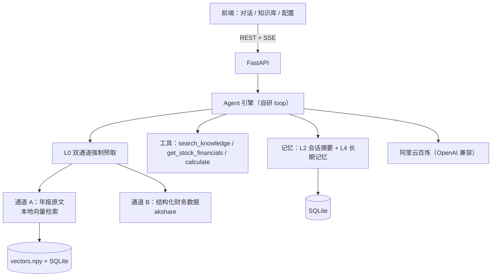

# FinAgent · 上市公司财报分析 Agent

> 用自然语言问一家 A 股上市公司的财报，Agent 自动取来**年报原文**和**结构化财务数据**，
> 给出**带来源标注**的回答 —— 不用在年报 PDF、行情软件、计算器之间来回切。


单机运行 · 只读公开数据 · 不构成投资建议

📄 深入阅读：[架构说明](docs/architecture.md) · [Prompt 策略](docs/prompt-strategy.md) · [踩坑记录](docs/pitfalls.md) · [评测结果](eval/results.md)

---

## 1. 它解决什么问题

想搞清"某公司 2025 年营收多少、同比怎么变、管理层怎么解释"，得翻 100–300 页年报、
另开数据网站、自己算 —— 成本高，还容易抄错数。

**一句话问出结论，且每个结论都能追到出处。**

## 2. 效果（20 题实测）

| 指标 | 结果 |
|---|---|
| 完成题数 | 20 / 20（每题开新会话） |
| 自动初判通过 | 19 / 20（余 1 题为脚本拒答关键词漏判，人工复核确认回答正确） |
| 首字延迟 中位 / P95 | 1.82s / 2.34s |
| 完成延迟 中位 / P95 | 10.44s / 17.06s |
| 可疑引用 / 未接地 / 报错 | 0 / 0 / 0 |

评测前先**冻结配置快照**（模型、工具开关、记忆参数），逐题明细见 [`eval/results.md`](eval/results.md)。

一次典型问答：

```text
问：贵州茅台 2025 年的营业总收入是多少？用亿元表示

答：1,720.54 亿元（B）
     ↑ 来源标注：A = 年报原文片段（带文件名与页码），B = 结构化财务数据（akshare）
```

> 也如实说明：这轮评测暴露了一个**已知缺陷** —— 模型心算单位换算会错 10 倍。
> 修法（结构化数据自带换算结果 + 强制走 `calculate`）已落地，但评测尚未重跑，见第 11 节。

## 3. 快速开始

需要 Python 3.10+ 和一个阿里云百炼（DashScope）API Key —— 用于**向量化**与**生成回答**。

Windows（PowerShell）：

```powershell
python -m venv .venv
.venv\Scripts\Activate.ps1
pip install -r requirements.txt

Copy-Item .env.example .env     # 打开 .env，填入 DASHSCOPE_API_KEY

python scripts\ingest.py --dir data\raw --limit 1   # 先入 1 份验证链路
python scripts\ingest.py --dir data\raw             # 再入全部 4 份年报
python scripts\ingest.py --stats                    # 看索引状态

python -m uvicorn backend.main:app --reload
# 打开 http://127.0.0.1:8000
```

macOS / Linux：

```bash
python3 -m venv .venv && source .venv/bin/activate
pip install -r requirements.txt

cp .env.example .env            # 填入 DASHSCOPE_API_KEY

python scripts/ingest.py --dir data/raw
python -m uvicorn backend.main:app --reload
```

几点说明：

- 仓库里已附 4 份年报 PDF（茅台、美的 2024 + 2025，共约 17MB），也可以换成你自己的年报；
- 入库要调用云端 embedding，约 2100 个切块，**首次入库会产生少量 API 费用**，耗时看网络；
- 不填 Key 也能把服务起起来（`/health` 显示 `llm_ready: false`），只是问答与入库不可用；
- 其余可选项（模型调用轮次、输出上限、工具结果上限）都在 `.env.example` 里注释好了。

### 数据库：默认 SQLite，可切 MySQL

默认 `DB_BACKEND=sqlite`，**不配任何东西就能跑**，数据落 `data/app.db`（`.env` 不进 git，
所以别人 clone 下来拿到的就是这个默认值）。

要用 MySQL：先建库（`CREATE DATABASE finagent DEFAULT CHARACTER SET utf8mb4`），
再把 `.env` 改成 `DB_BACKEND=mysql` 并填连接参数 —— **不用改代码**。

> 已在 **MySQL 8.4 实测跑通**：6 张表由同一套建表逻辑生成、2104 个切块写入，
> 问答 / 记忆 / 配置 / 检索全流程正常，**检索结果与 SQLite 完全一致**。

**三条约定（防止"双后端"变乱）**：

1. 业务 SQL 只用两库都认的**公共子集** —— 不写 `ON CONFLICT` / `INSERT OR REPLACE`，需要 upsert 就写成"先判断再写"；
2. 建表语句用 `dbconn.py` 里的**类型别名**拼（`PK` / `KEY_STR` / `INT` / `REAL`），方言只出现在那一个文件；
3. **向量文件按后端分目录**（`data/index/{sqlite,mysql}/vectors.npy`）—— 向量在文件里、元数据在库里**必须成对**，所以**换后端要重新入库**。

## 4. 功能

| 页面 | 能力 |
|---|---|
| **对话** | 多轮、流式输出、Markdown、工具调用可见、引用出处（文件/页码/相似度）、会话侧栏 |
| **知识库** | 上传 PDF → 自动解析/切分/向量化/建索引；文档管理与**检索测试**（不经模型，用来调 chunk 与召回） |
| **配置** | 系统提示词、模型、工具开关、记忆策略（保留条数/压缩阈值/提炼间隔）、长期记忆管理与工作台统计 |

## 5. 架构



**云端只在两处参与**：文本向量化、生成回答。召回与比对全在本地完成。

## 6. 关键实现

### 6.1 双通道强制预取（本项目的核心）

**问题**：把 RAG 做成"让模型自己调的工具"，实测**不可靠** —— 问"美的 2025 营收"，
模型会跳过工具直接凭记忆答，甚至断言"尚未发布 2025 年报"（语料里明明有）。

**做法**：涉及公司事实/数字的问题，**由代码保底取资料**，不问模型要不要查：

| 通道 | 内容 | 什么时候取 |
|---|---|---|
| **A** | 年报原文片段（本地检索，带文件名 + 页码） | 命中定性信号 |
| **B** | 结构化财务数据（akshare，**自带亿元换算**） | 命中数值信号 |

资料取好后按通道标注注入本轮消息，并要求模型**在结论后标明用的是哪条通道**。

**兜底**（硬校验，不靠模型自觉）：

- **引用校验** —— 回答里的「片段 N」不在本轮 citations 里 → 报警；
- **接地校验** —— 该取资料却什么都没取到 → **直接拒答**，不让它凭记忆作答。

### 6.2 自研 Agent 循环

`决策 → 工具执行 → 回填 → 再决策`，最多 5 次模型调用。不用框架是为了**能讲清整条链路**。

### 6.3 入库管线：难点在版面，不在扩展名

`pypdf` 抽正文 → 去页眉页脚 → 自动抽页码进 metadata → 按页切 400–600 字（重叠 90）→
云端向量化 → 本地索引（numpy + SQLite）。

**按页切、不跨页**：页码是引用锚点，跨页合并会让"这块属于哪页"说不清。

### 6.4 四层记忆

| 层 | 内容 | 实现 |
|---|---|---|
| L1 | 单次请求内的工作记忆 | 进程内 |
| L2 | 多轮原文 + **滚动摘要** | 超阈值把最老一半压成摘要，保留最近 N 条原文 |
| L3 | 年报切块与向量 | 本地持久化 |
| L4 | **关于用户**的偏好/常用公司/口径 | 自动提炼，**可见可删**，注入 system prompt |

## 7. 技术选型

| 决策 | 选择 | 为什么 |
|---|---|---|
| 编排 | **自研 loop**（非 LangChain） | 能讲清原理；框架会把这层藏起来 |
| 向量化 | **云端** text-embedding-v4 | 本机零算力；依赖从约 600MB 降到几十 MB |
| 向量存储 | **SQLite + numpy**（非向量数据库） | 约 2000 块规模下点积 < 5ms，能省几百 MB 依赖 |
| 关系数据库 | **SQLite / MySQL 双后端**（`DB_BACKEND` 切换，默认 SQLite） | 默认零部署让人 clone 即跑；需要时切 MySQL，**只改 `.env` 不动代码** |
| 格式 | **只做文字型 PDF** | 实测巨潮年报与公告均为 PDF，不为"多格式"造需求 |
| 工具 | **全部只读** | 从架构上杜绝越权，不依赖模型自觉 |

## 8. 项目结构

```
backend/
  main.py            # FastAPI 入口 + 托管前端
  config.py          # .env 读取与默认系统提示词
  dbconn.py          # 数据库抽象层：SQLite / MySQL 双后端
  db.py              # 会话 / 消息 / 记忆 / 应用配置 / 统计
  llm.py             # 云端客户端（流式 + 工具调用 + 非流式短调用）
  agent/             # loop.py · prompts.py · gate.py · grounding.py · memory.py · rewrite.py · context.py
  rag/               # loader.py · splitter.py · embedder.py · store.py · retriever.py · ingest.py
  tools/             # registry.py · knowledge.py · finance.py · calc.py
  api/               # chat.py · documents.py · config.py · stats.py · memories.py
frontend/            # index.html · knowledge.html · config.html · assets/
scripts/             # ingest.py（入库）· eval.py（20 题评测）
eval/                # questions.yaml · results.md
data/raw/            # 年报 PDF（随仓库分发）
data/app.db          # SQLite 数据库；data/index/ 向量索引（均为生成物，已 gitignore）
docs/                # 架构 / Prompt 策略 / 踩坑记录
```

## 9. 评测

```bash
python scripts/eval.py --limit 3    # 先跑 3 题（服务需先起）
python scripts/eval.py              # 跑全部 20 题，写出 eval/results.md
```

脚本会**先冻结并记录配置快照**（否则结果不可比），每题开新会话，
输出首字/完成延迟、token、引用数、可疑引用、是否未接地。
自动初判只做粗筛，**最终判定仍需人工对照 `expect` 逐题确认**。

## 10. 踩坑与优化（面试重点）

1. **页眉页脚清理误伤正文** —— 第一版按"跨页高频行"删，把 `单位：元 币种：人民币` 也删了。
   → 改为**只在每页首尾两行**判定。
2. **页码抽不到** —— 以为在页脚，实测在**页首**（`60 / 143`、`- 59 -`、还有页首光秃数字）。
   → 首尾都扫 + 光秃数字加"接近 PDF 页序"兜底。
3. **伪引用** —— 多轮追问时模型不检索却写「片段 3」（被历史里的编号诱导）。
   → 送模型前**剥掉历史里的引用编号** + 引用合法性校验。
4. **模型跳过工具凭记忆作答** —— 提示词软化无效。
   → 先 `tool_choice="required"` 强制，最终升级为**双通道强制预取**（由代码保底）。
5. **10 倍单位换算错误** —— `172,054,171,890.91 元` 被写成「172.05 亿元」。
   → 让结构化数据**自带亿元换算**，模型不必心算；并给注入块附单位参照表。
6. **流式下 tool_calls 是增量拼接的** —— 参数分多个 chunk 到达，必须按 index 累积。
7. **`usage` 是 SDK 对象**，直接 `json.dumps` 会炸 → 转普通 dict。
8. **两个参数管同一件事** —— `keep_recent` 与 `HISTORY_MAX_MESSAGES` 互相覆盖，
   导致配置页那个旋钮形同虚设 → 合并成一个，并加**后端校验与钳制**。

完整版（12 条，含现象 → 根因 → 修法 → 教训）见 [`docs/pitfalls.md`](docs/pitfalls.md)。

## 11. 已知问题与边界

- **单位换算缺陷**：评测里出现过 10 倍换算错误，代码已改为"结构化数据自带换算 + 强制 `calculate`"，**但尚未重跑评测**。
- **多步题偏慢**：串多个工具的题目 token 与耗时明显更高（实测单题最高 15518 token / 17.1s）。
- **召回质量受检索词影响**：模型自拟检索词带公司名时召回反而变差，说明单看向量分数不可靠，**重排实验尚未做**。
- **akshare 取数约 +7s**，同一公司反复问会重复取数（待加缓存）。
- **评测是 20 题自评**，小样本，结论只作趋势参考。
- **单机单用户**：接口无鉴权、上传未做大小与文件名净化，请勿直接暴露到公网。
- **本版不做**：Docker、扫描件 OCR（明确报错不静默降级）、PDF 以外的格式、向量数据库、LangChain 版对比。

## 12. 想快速读懂这个项目？

| 顺序 | 文件 | 看什么 |
|---|---|---|
| 1 | `backend/agent/loop.py` | 一轮问答的完整编排：改写 → 门控 → 预取 → 循环 → 校验 |
| 2 | `backend/agent/gate.py` | "要不要取资料"如何变成确定性判断（而不是靠模型自觉） |
| 3 | `backend/agent/grounding.py` | 双通道预取与注入块组装 |
| 4 | `backend/rag/loader.py` | 版面处理：页眉页脚清理与页码抽取 |
| 5 | `backend/dbconn.py` | SQLite / MySQL 双后端抽象层 |
| 6 | `docs/pitfalls.md` | 12 条实测踩坑：现象 → 根因 → 修法 → 教训 |

---

**数据来源**：巨潮资讯网（年报原文）、akshare（结构化财务数据），均为公开信息，仅用于学习。
**免责**：本工具不构成任何投资建议。
